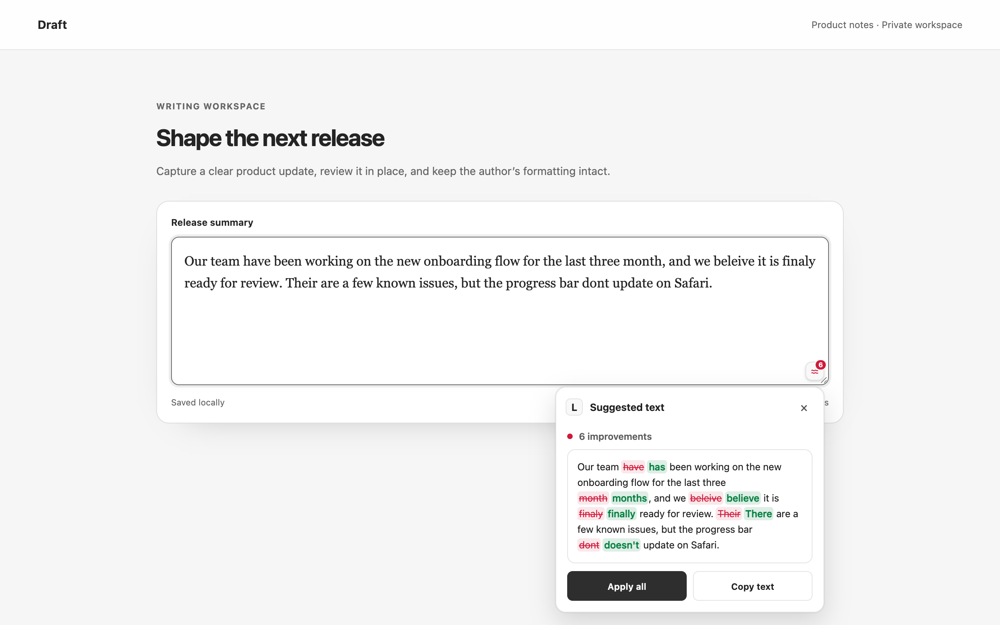
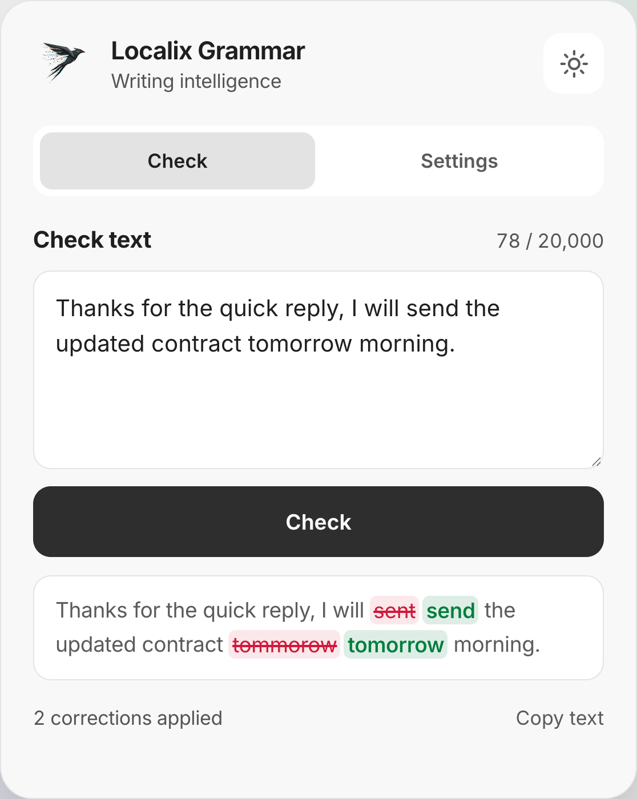
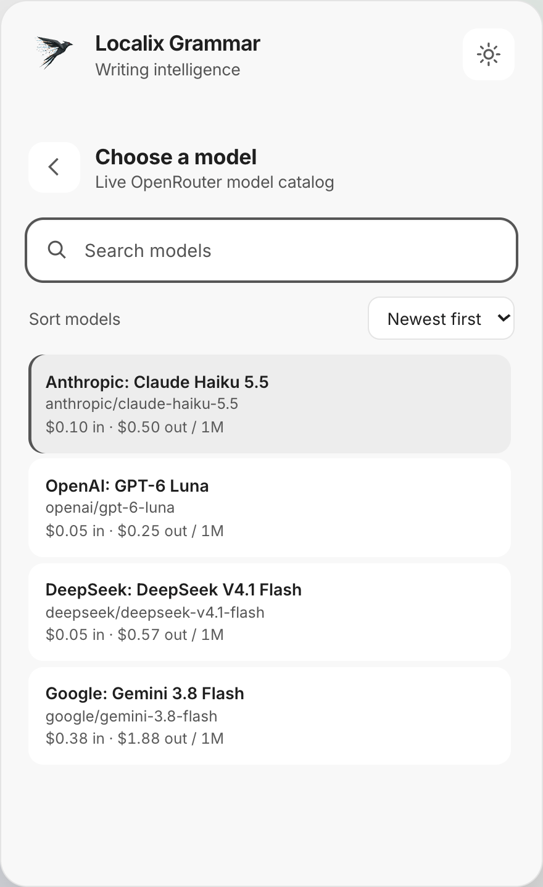
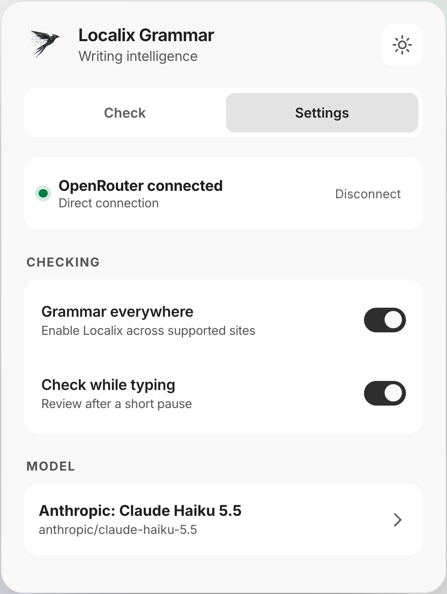

<p align="center">
  <a href="https://localix.ai/">
    <picture>
      <source media="(prefers-color-scheme: dark)" srcset="public/logo-dark.svg">
      
    </picture>
  </a>
</p>

<h1 align="center">Localix Grammar</h1>

<p align="center">
  <strong>A precise, privacy-aware proofreader for Chrome, on any OpenRouter model</strong>
</p>

<p align="center">
  It fixes spelling, grammar and punctuation in the editor you are already typing in, shows every change as a tracked edit, and applies them in one click. Your key stays in the extension; your text goes only to the model you chose.
</p>

<p align="center">
  <a href="https://github.com/rsaryev/llx-grammar/actions/workflows/ci.yml"></a>
  
  <a href="LICENSE"></a>
  
  
  
</p>

<p align="center">
  <a href="#try-it">Try it</a> ·
  <a href="#how-a-check-works">How it works</a> ·
  <a href="docs/user-guide.md">User guide</a> ·
  <a href="#privacy">Privacy</a> ·
  <a href="https://localix.ai">localix.ai</a>
</p>

<p align="center">
  <picture>
    <source media="(prefers-color-scheme: dark)" srcset="docs/assets/overlay-dark.png">
    
  </picture>
</p>

Localix Grammar is one request per check: the text goes to the model with a short proofreading prompt, the model returns the corrected text, and the extension derives every suggestion itself by comparing the two. The model never names offsets, so a suggestion cannot point at the wrong place. Three ways to use it:

| Where              | How                                                          | What you get                                                                 |
| ------------------ | ------------------------------------------------------------ | ---------------------------------------------------------------------------- |
| **In any editor**  | Type, or press the button beside the field                   | Tracked changes next to your text, applied in one click with formatting kept |
| **In the popup**   | Paste text copied from anywhere                              | The same review, with the corrected text ready to copy                       |
| **On a selection** | Right-click → **Correct selected text with Localix Grammar** | A check of just the selected text, in rich-text frames too                   |

It works in text fields and `contenteditable` editors, and stays out of passwords, one-time codes, payment and identity fields, read-only controls and spreadsheet cells. Checks pause per site or everywhere. The interface follows the system theme, or stays light or dark.

<p align="center">
  <picture>
    <source media="(prefers-color-scheme: dark)" srcset="docs/assets/popup-check-dark.png">
    
  </picture>
  <picture>
    <source media="(prefers-color-scheme: dark)" srcset="docs/assets/popup-models-dark.png">
    
  </picture>
  <picture>
    <source media="(prefers-color-scheme: dark)" srcset="docs/assets/popup-settings-dark.png">
    
  </picture>
</p>

## Try it

Requires Node.js 22.19 or later and Chrome or Chromium 127 or later.

```bash
git clone https://github.com/rsaryev/llx-grammar && cd llx-grammar
npm ci --ignore-scripts
npm run build                                # the unpacked extension, in dist/
```

Open `chrome://extensions`, turn on **Developer mode**, choose **Load unpacked** and select `dist/`. Then open the popup and connect: **Continue with OpenRouter** signs in through OAuth, or paste an API key. Pick a model, and type in any editor.

## How a check works

1. **The text is sent as data.** It travels inside `<text>` tags with a prompt that says to correct errors only: no rewording, no answering what the text asks, nothing changed inside code, URLs or names. Instructions written in the text are proofread like any other sentence.
2. **The model returns the corrected text**, as the argument of one tool call. No offsets, no categories, no explanations to get wrong.
3. **The extension derives the changes** by comparing the two texts and growing each difference to whole words, so a suggestion reads "teh → the", never "eh → he".
4. **The answer is checked before you see it.** A reply much shorter or longer than the original is rejected as an answer or a rewrite; one cut off by the output limit is retried once with reasoning turned down.
5. **Applying keeps the page intact.** Plain fields get native input events; rich text is changed through DOM ranges, never `innerHTML`, so links, emphasis and the cursor stay where they were.

The design, with the reasons for each choice, is in [research and architecture](docs/research-and-architecture.md).

## Privacy

- Text is sent only when a check runs, only to OpenRouter, and only to the model you selected.
- The API key lives in extension-only storage in the service worker. Page scripts and content scripts never receive it.
- No analytics, no advertising, no browsing history, no remote code: all JavaScript, CSS and fonts ship in the package.
- Network access is limited to `https://openrouter.ai/*`.

See the [privacy policy](PRIVACY_POLICY.md) and the [reason for each permission](docs/permissions-and-privacy.md).

## Develop

```bash
npm run check                                # format, lint, types, unit tests, build, bundle checks
npm run test:e2e                             # the built extension in Chromium, OpenRouter mocked
npm run verify                               # both, with coverage and an audit
npm run screenshots                          # the images on this page and for the store
npm run zip                                  # the archive for the Chrome Web Store
```

The screenshots are captured from the production build by [scripts/capture-screenshots.mjs](scripts/capture-screenshots.mjs), with fixed model responses, so they contain no account data. `npm run hooks` turns on a pre-commit hook that refreshes them when a commit changes the interface.

[User guide](docs/user-guide.md) · [Contributing](CONTRIBUTING.md) · [Security](SECURITY.md) · [Changelog](CHANGELOG.md)

## License

[MIT](LICENSE)
